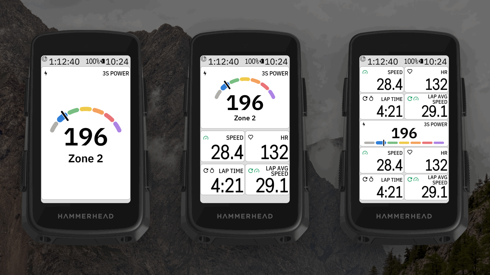
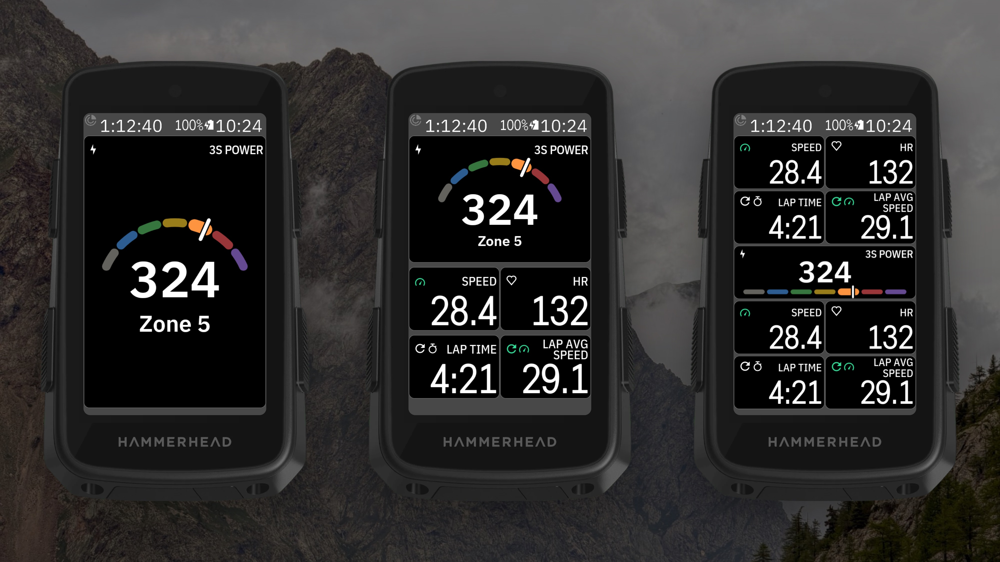

<!-- docs.sh: generated from docs/app.yml. Edit that file and run setup/docs.sh, not this block. -->

# BigWatts for Karoo 3

Listed on the Karoo as **DDB BigWatts**, next to the other DDB apps.

A Hammerhead Karoo 3 data field that shows your power **big, in the middle**, coloured by the
power zones in your Karoo rider profile. Any field size: the number grows to fill it.

- **Two looks:** BigWatts or Karoo (the Karoo's number font). Both have the Karoo's header: power icon and field name, e.g. 3S POWER.
- **Number:** neutral, in the zone colour, or a zone gauge (an arc around the number or a bar
  under it, all seven zones with your current one raised). The whole field can take the zone colour.
- **Zone time** (optional): the gauge's zones grow with the time you spend in each during the ride.
- **Under the watts**, smaller: your zone (`Z4`, `Zone 4` or `Zone 4 · Lactate Threshold`), heart
  rate, or average watts for the ride.
- **Power:** instant, 3 s, 5 s or 10 s average.
- Everything is set on the app's **Settings** page (open **DDB BigWatts** from the Karoo's app list).
  The field has no tap action, so a long-press still changes the field as usual.

There's a [guide with pictures](docs/guide/README.md). Building it yourself or making a release: see [docs/DEVELOPING.md](docs/DEVELOPING.md). Problems or ideas: [Issues](https://github.com/Dubadai/karoo-bigwatts/issues). The big-watts styles come from [BetterIntervals](https://github.com/Dubadai/karoo-betterintervals).

## Install on your Karoo

1. On your phone, open the latest release and share the `.apk` link to the **Hammerhead
   Companion** app (or with a computer: `adb install bigwatts.apk`).
2. In a ride profile, add **DDB BigWatts → BigWatts** to a page, at any size.
3. Open **DDB BigWatts** from the app list to pick the style, the line above the watts and the power.

Values show `--` when the power meter (or heart rate strap) isn't connected. Colours need power
zones in your Karoo rider profile.

<!-- /docs.sh -->
