# BigWatts guide

BigWatts is one data field: your power in big numbers, coloured by your Karoo power zones.

## Add it to a ride page

In **Profiles**, open a profile, then **Data Pages**. Add a field and pick **DDB BigWatts → BigWatts**.
It works at any size, and looks best **two rows tall or more**. In a one-row field you get just
the number (and the zone bar with the gauge).

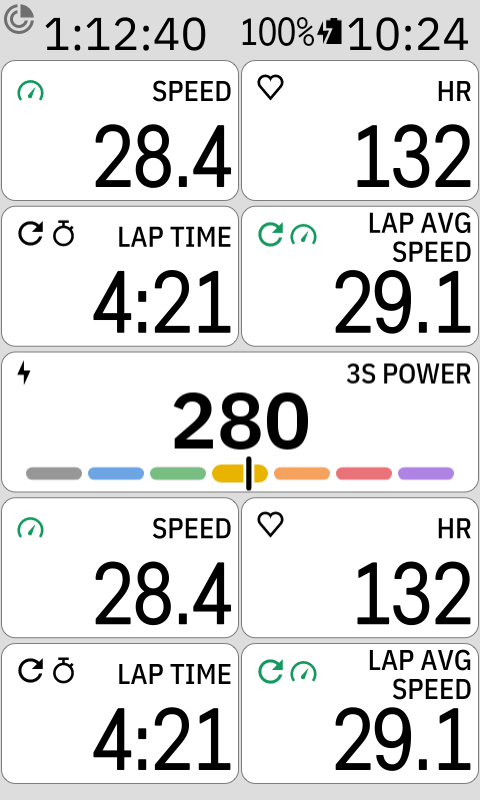 
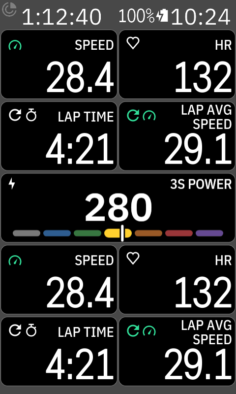

## Settings

Open **DDB BigWatts** from the Karoo's app list. The **Example** at the top shows the field at half
a page with your choices, and changes as you tap. Rows that don't apply to your choices are hidden
or greyed out.

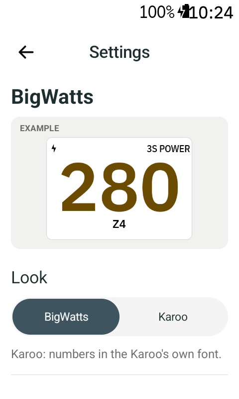

- **Look**: **BigWatts** (our own font) or **Karoo** (the Karoo's font). Both have the Karoo's
  header: a power icon top left and the field name, such as 3S POWER, top right.
- **Number**
  - **Neutral**: black (white in dark mode).
  - **Zone colour**: the number takes the colour of your power zone.
  - **Gauge**: the seven zones in their colours, your current zone thick and bright, a needle at
    your watts.
- **Gauge** (only with the gauge): **Arc** around the number, or a flat **Bar** under it. A
  one-row field always uses the bar.
- **Zone time** (only with the gauge): each zone grows thicker with the time you spend in it this
  ride, so you see where your ride went. The zone you've ridden most is the thickest; a zone you
  haven't ridden stays as it is. **All time** counts coasting (0 W) as zone 1, **Pedalling** leaves
  it out, **Off** (the default) keeps the gauge as it is. Counts while the ride records, starts
  again with every ride, and isn't shown in a one-row field.

  
- **Under the watts** (smaller, it's secondary): your **zone**, your **heart rate**, or your
  **average watts** for the whole ride.
- **Zone name** (only with Zone under the watts): **Short** `Z4`, **Compact** `Zone 4`, or **Long**
  `Zone 4 · Lactate Threshold` (the Karoo's own zone names).
- **Power**: **Instant** reacts fastest; **3 s**, **5 s** and **10 s** are smoother.

All pictures: half a page, 280 W (zone 4), during a ride.

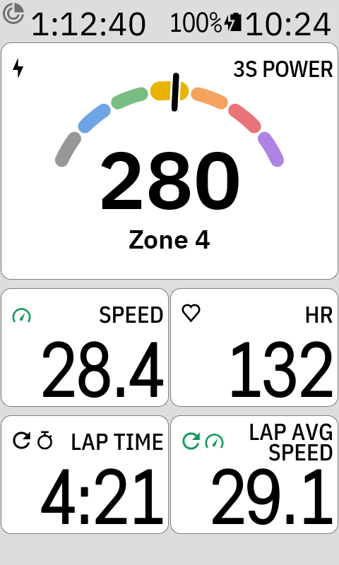 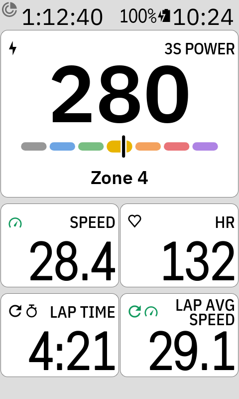 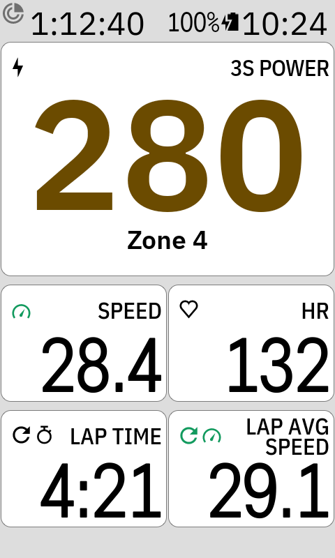 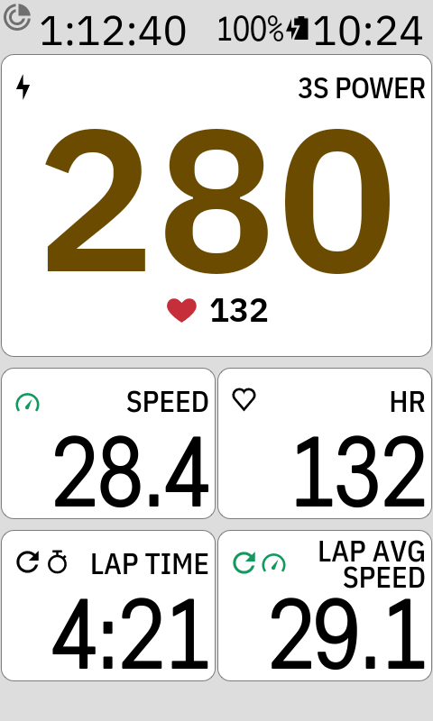 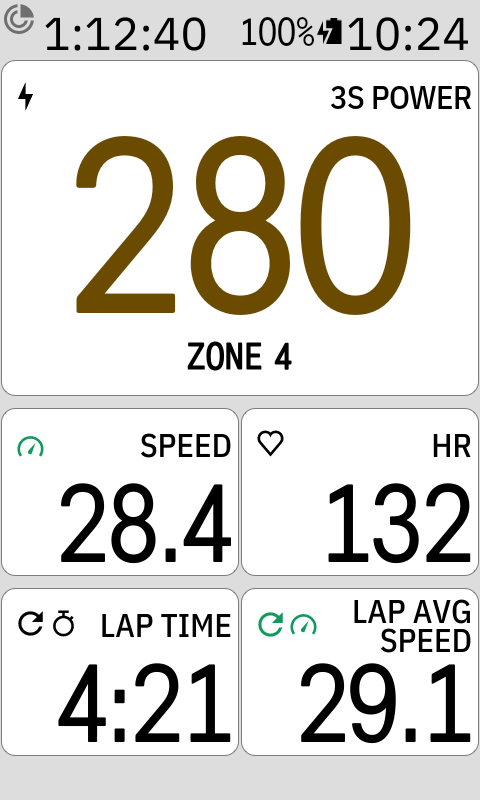 
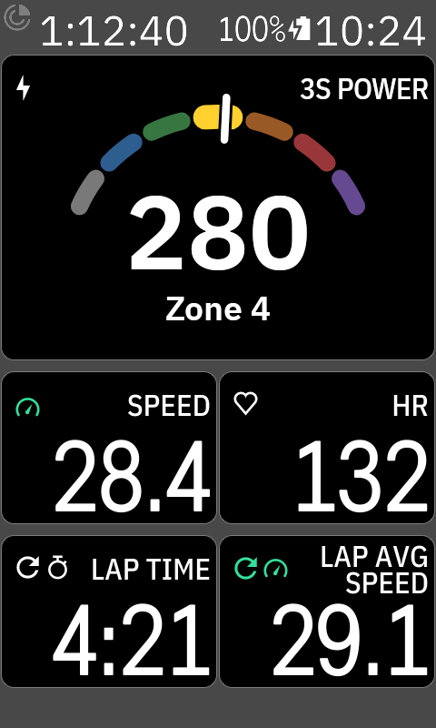 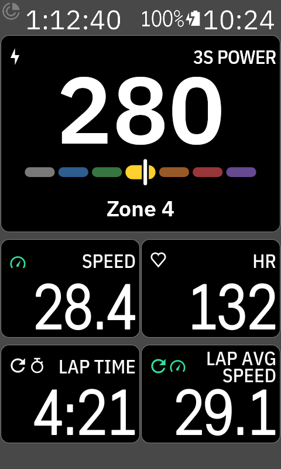 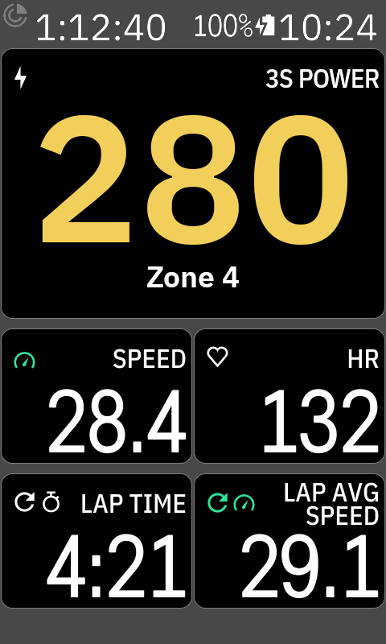 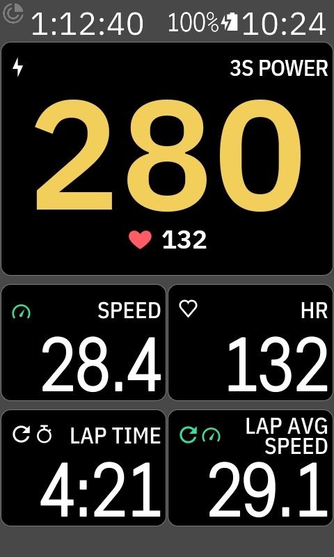 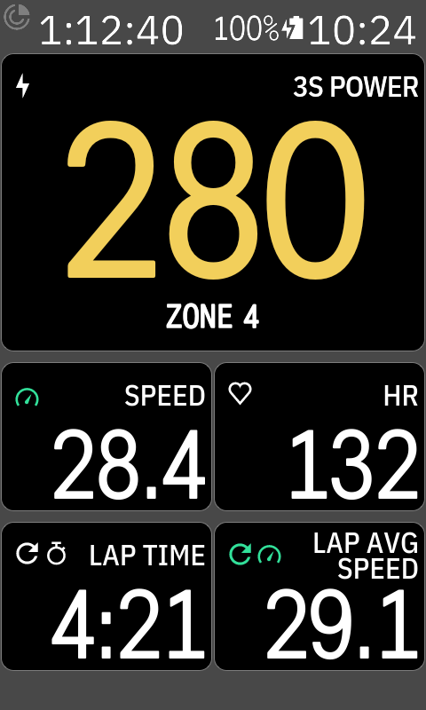

The field has no tap action on purpose: a long-press on it changes the field, as on any Karoo field.

## Zones

The zones are the power zones in your Karoo rider profile (set from your FTP): Z1 grey, Z2 blue,
Z3 green, Z4 yellow, Z5 orange, Z6 red, Z7 purple. Without zones the number stays plain.
`--` means no power meter (or heart rate strap) is connected.
